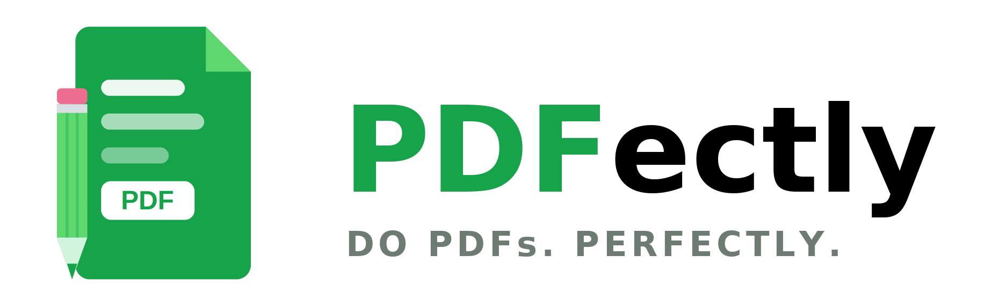
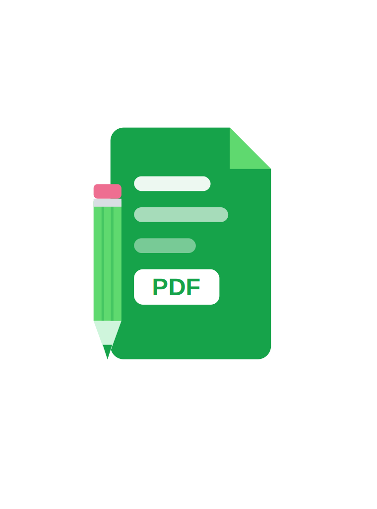

<picture>
  <source media="(prefers-color-scheme: dark)" srcset="pdfectly_logo_horizontal_on_dark.png">
  
</picture>

**A fast, free PDF reader and editor for Windows.**

Read, edit, organize, convert, merge, split and compress PDFs in one desktop app. No sign-up, no watermarks, no cloud — your files never leave your computer.

**[⬇ Download PDFectly for Windows](https://github.com/chethanavishmika/PDFectly-releases/releases/latest)** · [All releases](https://github.com/chethanavishmika/PDFectly-releases/releases) · [Report a problem](https://github.com/chethanavishmika/PDFectly-releases/issues)

Highlights · Download & install · Quick start · Read · Edit · Organize pages · Tools · Shortcuts · Updates · Privacy

---

## Interface

---

## Highlights

- **Edit real text.** Click any text on the page and edit it in place — font, size and colour included. What you type stays editable and searchable.
- **Convert without losing the look.** PDF to Word keeps the document editable *and* close to the original layout. Word to PDF keeps the layout faithful.
- **Organize pages like cards.** Rotate, delete, insert and drag pages into a new order. Crop, straighten, resize and extend pages — with a live preview.
- **Sign and stamp.** Type, draw or import a signature and place it with a click. Add watermarks, page numbers, headers & footers, and stamps.
- **Undo everything.** Every change to a document can be undone — including page edits, crops and resizes.
- **Free, private, offline.** No account, no telemetry, no cloud processing. PDFectly works fully offline.

---

## Download & install

1. Download the latest installer from the **[Releases page](https://github.com/chethanavishmika/PDFectly-releases/releases/latest)** — the file is named `PDFectly_<version>_x64-setup.exe`.
2. Run the installer and follow the setup wizard.
3. PDFectly opens. Double-click any PDF file to open it in PDFectly.

> Windows may show a SmartScreen warning the first time you install ("Windows protected your PC"). Click **More info → Run anyway**. PDFectly is new software, so Windows hasn't seen it before yet.

**System requirements:** Windows 10 or later, 64-bit.

---

## Quick start

| To do this | Do this |
|---|---|
| Open a PDF | Double-click the file, drag it onto the PDFectly window, or use **Files → Open** |
| Move around | Scroll, use the page thumbnails on the right, or press `Space` / arrow keys in slideshow mode |
| Zoom | `Ctrl` + `+` / `Ctrl` + `-`, or `Ctrl` + `0` to reset to 100% |
| Save your changes | `Ctrl` + `S` |
| Undo / redo | `Ctrl` + `Z` / `Ctrl` + `Y` |

---

## Read

- **Thumbnails** show every page on the right. Click one to jump to it. Select several pages with `Shift`-click (a range) or `Ctrl`-click (individual pages).
- **Slideshow** presents the document page by page — use the arrow keys or `Space` to move on, `Esc` to exit.
- **Dark mode** is available from the theme menu. Dialogs and menus follow the theme.

## Edit

Open the **Edit** tab on the ribbon, or press the shortcut key for a tool:

| Tool | What it does |
|---|---|
| **Edit Text** (`E`) | Click text on the page and edit it directly |
| **Edit Object** (`O`) | Select and move objects and annotations |
| **Add Text** (`T`) | Place a new text box anywhere on the page |
| **Add Image** (`I`) | Place an image on the page |
| **Brush** (`B`) | Draw freehand with adjustable size, hardness, opacity and flow. Click the pipette in the brush toolbar to pick a colour straight from the page |
| **Link** (`L`) | Drag a rectangle and attach a web link to it |
| **Attachment** (`A`) | Attach a file to the document |
| **Colour** (`C`) | Adjust a page's colours (Original, Vibrant, Soft Tone, Sharp Black) and brightness |
| **Watermark** (`W`) | Add a text watermark to pages |
| **Page Number** (`N`) | Add page numbers |
| **Header & Footer** (`F`) | Add a header or footer to pages |
| **Stamp** (`S`) | Place a stamp on the page |
| **Signature** (`G`) | Type, draw or import a signature, then click on the page where it goes |

Every edit is undoable with `Ctrl` + `Z`. Saving writes your changes into the PDF — text you edited stays real, selectable text.

## Organize pages

Open the **Page** tab to work with pages:

- **Rotate** pages left or right, **delete** pages, and **insert** blank pages, pages from another PDF, or pages from an image.
- **Reorder** by dragging page cards in the Page tab grid.
- **Crop, Straighten, Extend and Resize** — open the Crop dialog to fix a skewed scan, trim margins, add a border, or resize a page (for example to A4). The preview always shows the latest state of the page, and everything is undoable.
- **Delete several pages at once** — select them in the thumbnail panel and press the trash button once.

## Tools

The **Tools** tab holds the converters and document tools:

| Tool | What it does |
|---|---|
| **PDF to Word** | Editable Word document that stays close to the original look |
| **PDF to Excel** | Tables and data from the PDF as a spreadsheet |
| **PDF to PowerPoint** | Each page as a slide (slides are page images) |
| **PDF to PNG** | Every page as a PNG image |
| **Word to PDF** | A Word document converted to PDF, layout kept |
| **Image to PDF** | Images combined into a PDF |
| **Merge PDF** | Combine several PDFs into one |
| **Split PDF** | Split one PDF into several files |
| **Compress PDF** | Make the file smaller, with a real measured size before and after |
| **Fill Form** | Opens the PDF in the editor — fill it in with Add Text, Brush or Add Image, then save |

## Keyboard shortcuts

### General

| Keys | Action |
|---|---|
| `Ctrl` + `S` | Save |
| `Ctrl` + `Z` | Undo |
| `Ctrl` + `Y` / `Ctrl` + `Shift` + `Z` | Redo |
| `Ctrl` + `P` | Print |
| `Ctrl` + `+` / `Ctrl` + `-` | Zoom in / out |
| `Ctrl` + `0` | Reset zoom to 100% |
| `Delete` | Delete selected annotation |
| Arrow keys / `Space` | Slideshow next / previous |
| `Esc` | Close viewer · Exit slideshow · Cancel signature / colour picker |

### Tools (left panel)

| Key | Tool | Key | Tool |
|---|---|---|---|
| `V` | Select | `L` | Link |
| `H` | Hand | `A` | Attachment |
| `E` | Edit Text | `C` | Colour |
| `O` | Edit Object | `W` | Watermark |
| `T` | Add Text | `N` | Page Number |
| `I` | Add Image | `F` | Header & Footer |
| `B` | Brush | `S` | Stamp |
| | | `G` | Signature |

---

## Keep PDFectly up to date

PDFectly checks for updates itself — no need to re-download it by hand:

1. Open the **Help** tab and click **Check Updates**.
2. If a new version is available, click **Download & Install**. PDFectly downloads the signed update, verifies it, installs it and restarts on the new version.
3. If you are already on the latest version, it simply says so.

## Privacy

- **No account.** PDFectly never asks you to sign up or sign in.
- **No telemetry.** Nothing about your documents or how you use the app is sent anywhere.
- **Your files stay on your computer.** PDFs are opened, edited and saved locally. Update checks only ask the releases page whether a newer version exists.

## Feedback

Found a bug or want a feature? Use the **Feedback** button in the **Help** tab, or [open an issue](https://github.com/chethanavishmika/PDFectly-releases/issues).

## Version history

- **v0.2.1** — (2026-11-20). PDF to Word now builds a real numbered list, a single Heading1 title and 12pt body; the Select tool drags objects to move them keeping their font and bold; Text Tool (T) merges Add and Edit Text; in-app Translate panel; Convert menu opens the real tools.
- **v0.2.0** — (2026-11-20). Custom brush colour picker with a native Rust eyedropper, automatic splash version, and User Guide button.
- **v0.1.0** — First public release (2026-11-20). PDF reader & editor, page tools, converters, and in-app updates.

---

## Founder & Developer

  

  **Chethana Vishmika**

  Founder & Developer of PDFectly

Chethana Vishmika is the Founder and Developer of PDFectly. He is currently pursuing a Bachelor of Information and Communication Technology (BICT) degree at Uva Wellassa University of Sri Lanka. With a strong foundation in IT, software development and digital education, Chethana builds free tools that make everyday work simpler — PDFectly is his free, no-sign-up PDF reader and editor for Windows, built to be more powerful than the paid alternatives while keeping your files private on your own computer.

---

## License and credits

PDFectly is free to use. © 2026 Chethana Vishmika. All rights reserved.

Built with [Tauri](https://tauri.app/), [Rust](https://www.rust-lang.org/), [React](https://react.dev/), [pdf.js](https://mozilla.github.io/pdf.js/) and [pdf-lib](https://pdf-lib.js.org/) — thanks to the open-source projects that make it possible.

  

  Made by **Chethana Vishmika** — with pride in Sri Lanka.

